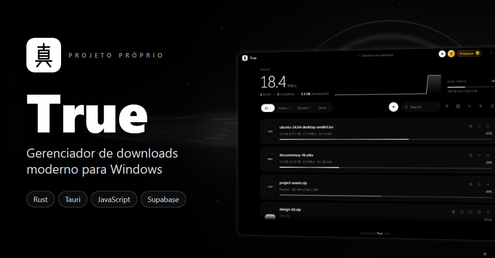
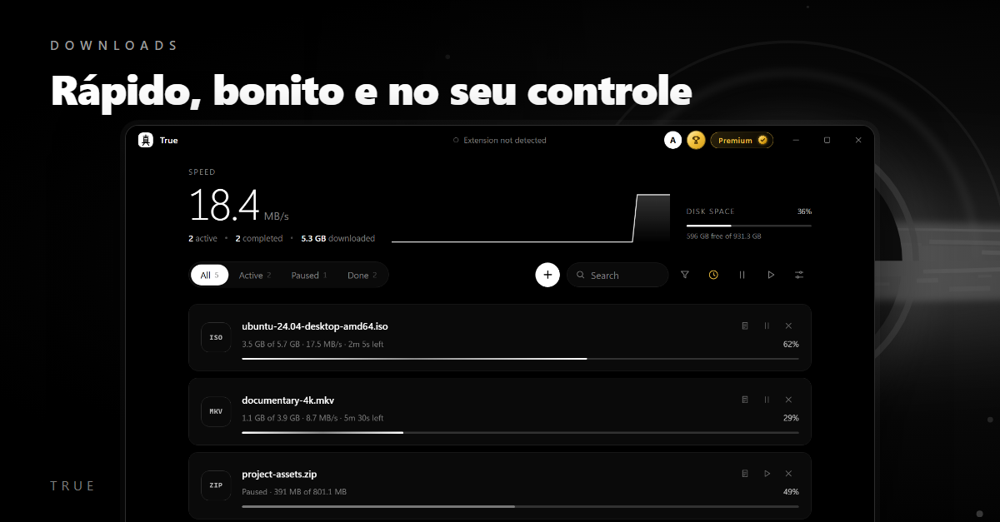
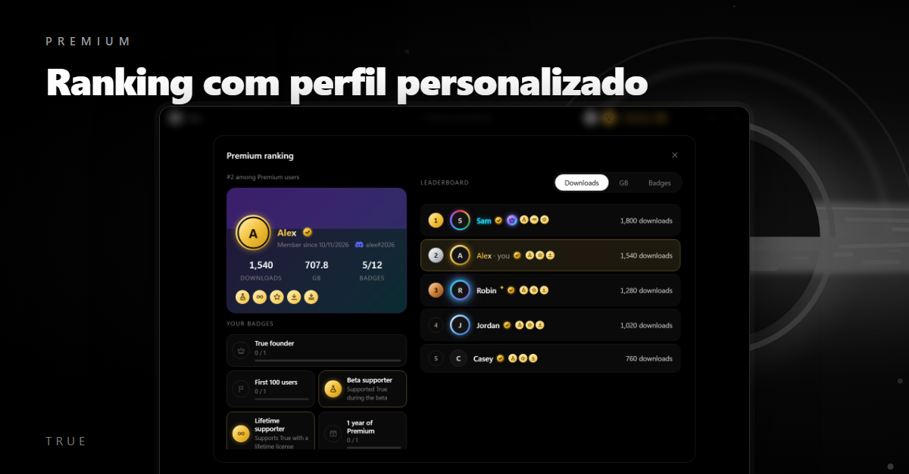

  

  <b>Rápido, bonito, com torrents, retomada inteligente e atualização automática.</b>

  

  
  
  
  

  

---

## Por que o True?

- **Simples de usar.** Instale, clique em um download no navegador e ele aparece no True. Sem configuração.
- **Rápido e leve.** Fica na bandeja do Windows, pronto para receber downloads a qualquer momento.
- **Seguro.** Atualizações assinadas digitalmente: o app só instala o que foi publicado por nós.
- **Seu jeito.** Temas, cores, idioma e até um perfil personalizado no ranking.

## Recursos

### Grátis

| | |
|---|---|
| **Downloads rápidos** | Pausar, continuar, limite de velocidade e fila |
| **Torrents e magnet links** | Arquivos `.torrent` e links `magnet:` direto no app |
| **Arraste e solte** | Solte links e arquivos `.torrent` em qualquer lugar da janela |
| **Link copiado** | Copiou um link de arquivo? O True oferece baixar |
| **Extensão do navegador** | Chrome, Edge, Brave, Opera e Opera GX, com guia dentro do app |
| **Arquivo duplicado** | Pergunta se você quer sobrescrever ou manter os dois |
| **Busca avançada** | Por nome, extensão, tamanho, data, endereço e status |
| **Espaço em disco** | Quanto resta no disco da sua pasta de downloads |
| **Abrir com o Windows** | Inicia escondido na bandeja |
| **8 idiomas** | Português, English, Español, Français, Deutsch, Italiano, Русский e 中文 |
| **Ranking** | Veja onde você está entre os usuários do True, com badges (entre com a sua conta) |
| **Atualização automática** | Detecta e instala versões novas com um clique |

### Premium

| | |
|---|---|
| **Retomada inteligente** | Reconecta e continua downloads interrompidos, mesmo depois de reiniciar |
| **Agendamento** | Comece um download na hora que quiser |
| **Verificação de vírus** | Depois de cada download, com chave opcional do VirusTotal |
| **True Game Mode** | Reduz a banda e segura notificações enquanto você joga |
| **Pastas por tipo** | Vídeos, músicas, imagens, documentos e programas cada um na sua pasta |
| **Limpeza automática** | Apaga sobras de downloads que falharam |
| **Notas nos downloads** | Anote o que quiser em cada arquivo |
| **Notificações personalizadas** | Sons, horário silencioso e tamanho mínimo |
| **Temas exclusivos** | Graphite, Midnight, Sand, Gold e o **Dark Glass** com transparência |
| **Perfil no ranking** | Moldura, banner, cor e efeito do nome, cartão de perfil e selo dourado |

  

  

## Como instalar

1. Abra a página de [**Releases**](../../releases/latest) e baixe o arquivo `True.Download_..._x64-setup.exe`.
2. Execute o instalador. Ele instala só para o seu usuário, sem pedir senha de administrador.
3. Pronto. O True abre e fica na bandeja do Windows.

> **O Windows mostrou "O Windows protegeu o computador"?**
> O instalador ainda não tem certificado de assinatura de código (é um processo pago, e estamos nele).
> Clique em **Mais informações** e depois em **Executar assim mesmo**. As **atualizações** do app, essas sim,
> são sempre verificadas por assinatura digital.

## Conectar ao navegador

Para que os downloads do navegador cheguem ao True, instale a extensão. É rápido:

1. No True, clique em **Extensão não detectada** (na barra superior) ou vá em **Configurações → Instalar**.
2. Escolha o seu navegador, ative o **Modo do desenvolvedor** e carregue a pasta indicada.

Sem a extensão, você ainda pode **arrastar links** para a janela do True ou simplesmente **copiar o link**.

## Perguntas frequentes

**É de graça?**
Sim, os recursos principais são gratuitos. O Premium libera os extras, e a licença é ativada dentro do app.

**Funciona no Mac ou no Linux?**
Por enquanto, só no Windows 10 e 11.

**Como o app se atualiza?**
Sozinho. Ele procura versões novas ao abrir, de tempos em tempos e ao voltar para a janela. Quando acha uma,
aparece um ícone brilhoso no canto: um clique baixa, confere a assinatura, instala e reinicia.

**O que o True guarda sobre mim?**
Só o necessário: sua conta (para o Premium) e, se você aceitar, seus totais no ranking. A detecção de link
copiado acontece no seu computador e pode ser desligada nas Configurações.

**Encontrei um problema ou tenho uma ideia.**
Abra uma [issue aqui](../../issues) ou use **Configurações → Enviar feedback** dentro do app.

## Suporte

- Problemas e sugestões: [Issues](../../issues)
- Novidades de cada versão: [Releases](../../releases)

O código-fonte do True não é público. Este repositório distribui os instaladores e as notas de cada versão.

---

<b>English</b>

### True: a modern download manager for Windows

Fast, good-looking and safe. True catches the downloads of your browser, handles torrents and magnet links,
resumes interrupted downloads and updates itself with signed releases.

**Install:** download `True.Download_..._x64-setup.exe` from the [latest release](../../releases/latest) and run it
(per-user install, no admin rights). If Windows SmartScreen warns you, click **More info → Run anyway**: the installer
is not code-signed yet, but every in-app update is verified with a digital signature.

**Free:** pause/resume, speed limit, torrents and magnet links, drag and drop links anywhere on the window,
"link copied" detection, browser extension for Chrome, Edge, Brave, Opera and Opera GX (with an in-app guide),
duplicate file prompt, advanced search, disk space, start with Windows, 8 languages, automatic updates.

**Premium:** smart resume, scheduling, virus scan, Game Mode, folders by file type, automatic cleanup, download notes,
custom notifications, exclusive themes (including Dark Glass) and a customizable ranking profile.

**Support:** [open an issue](../../issues) or use *Settings → Send feedback* inside the app.
The source code is private; this repository only distributes the installers and release notes.

<a href="TERMOS.md">Termos de Uso</a> · <a href="PRIVACIDADE.md">Política de Privacidade</a>

Feito com carinho · True

